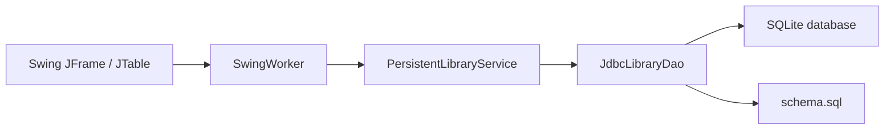

# BookBridge TSA4 Architecture

The UI reads controls and requests service operations. The service validates input. The DAO performs parameterized SQL and resource-safe transactions. Successful operations trigger a background refresh, and the refresh updates Swing models on the Event Dispatch Thread.
